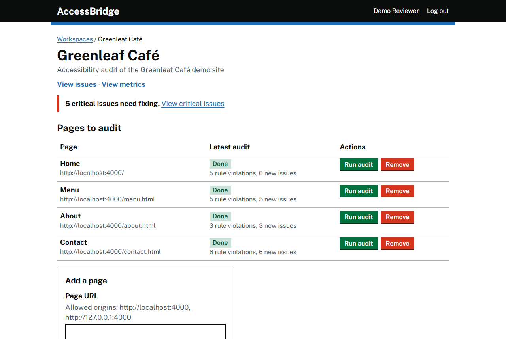
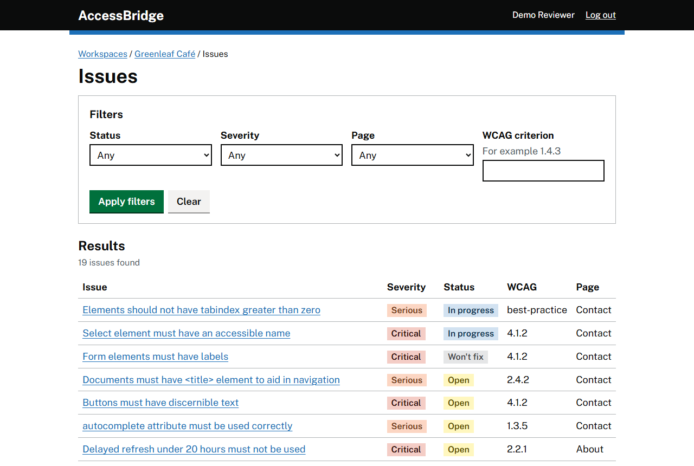
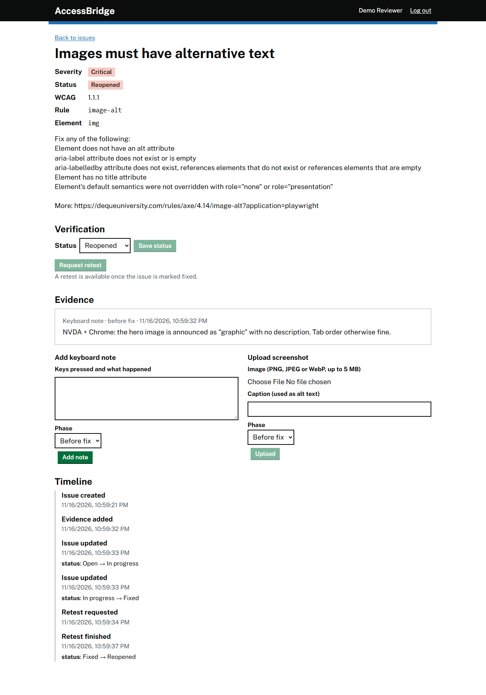
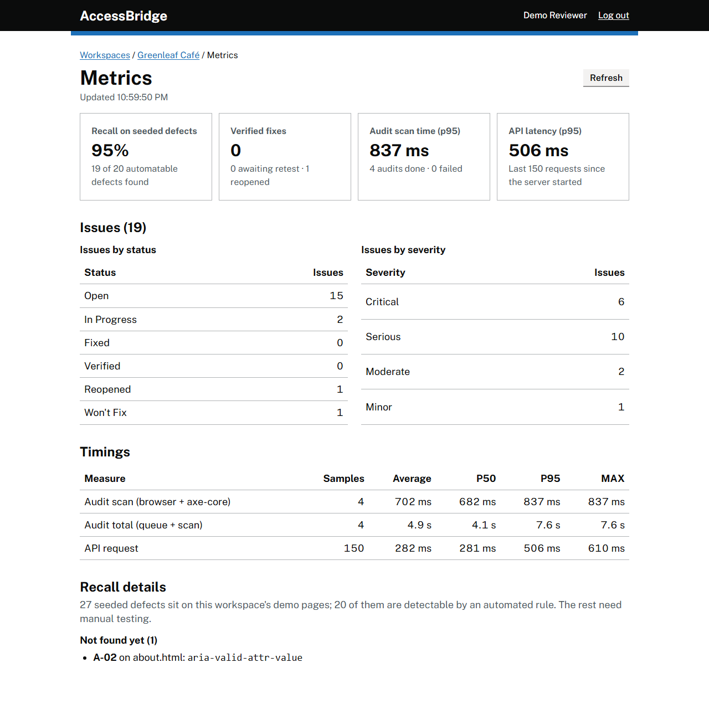
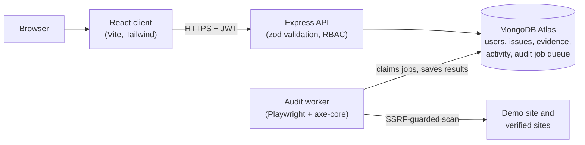

# AccessBridge

[](https://github.com/ShaishtaP/accessbridge/actions/workflows/ci.yml)

**An accessibility issue tracker that turns page audits into verified fixes.**

Teams audit web pages with Playwright and axe-core, track every finding as an issue with severity and WCAG criterion, attach evidence (screenshots, keyboard-navigation notes), fix it, and then *prove* the fix with a retest. An issue is only verified once a fresh scan of the page passes; the original finding, its evidence and the full timeline are kept, so every closure is auditable.

**Live demo:** [accessbridge-app-sp.onrender.com](https://accessbridge-app-sp.onrender.com) · API health: [/api/health](https://accessbridge-api-sp.onrender.com/api/health) · Demo site with seeded defects: [accessbridge-demo-sp.onrender.com](https://accessbridge-demo-sp.onrender.com)

> Hosted on free tiers: the API sleeps when idle, so the first request can take up to a minute. Audits are processed by a separately run worker (see [Deployment](#deployment)).

## Screenshots

| | |
|---|---|
|  |  |
| **Workspace:** pages to audit, one-click audits with live job status | **Issues:** filterable by status, severity, page and WCAG criterion |
|  |  |
| **Issue detail:** evidence, retest workflow and a timeline (here a fix that failed its retest and was reopened) | **Metrics:** recall against seeded defects, fixes, audit timings, API p95 |

## Results

Measured against the demo site, which has 27 deliberately seeded defects listed in [`seeded-defects.json`](demo-site/seeded-defects.json):

| Metric | Result |
|---|---|
| Recall on automatable seeded defects | **19 / 20 (95%)**, both locally and on the deployed demo site. The miss is A-02 (`aria-valid-attr-value`). |
| Defects that need manual testing | 7 of 27 (no axe rule can detect them); tracked with keyboard notes and screenshots |
| Audit scan time (browser + axe-core) | p50 494 ms, p95 666 ms on the local demo |
| API latency | p95 193 ms on Render's free tier (Singapore, database in Mumbai) |
| CI | 7 jobs on every push: server smoke suites against MongoDB, Playwright audit test, client build, 4 Docker images |

## Features

- **Auth and workspaces:** JWT login, workspaces with owner / admin / member roles, member management.
- **Pages and sites:** pages to audit are restricted to an allowlist plus the workspace's own sites, which must prove ownership with a meta tag or `/.well-known/accessbridge.txt` token.
- **Automated audits:** a queue stored in MongoDB; a worker claims jobs atomically (lock expiry, retries), scans the page with Playwright + axe-core 4.14 and turns each failing element into a deduplicated issue.
- **Issue tracking:** severity, WCAG criterion, axe rule and element selector; filters for status, severity, page and WCAG.
- **Evidence:** keyboard-navigation notes and screenshot uploads (5 MB limit, file signature check, member-only downloads), labelled as before or after the fix.
- **Fix verification:** marking an issue fixed enables a retest; the worker re-scans the page and sets the issue to *verified* or *reopened* on the same record.
- **Activity timeline:** every change is recorded with field-level before and after values.
- **SSRF guard:** DNS resolution with private, loopback, link-local and reserved IP blocking (IPv4 and IPv6), every request and redirect re-checked, service workers blocked, navigation and scan timeouts.
- **Metrics:** recall, verified fixes, audit scan and queue time, and API p95 latency from an in-memory request timer.
- **Accessible UI:** labelled fields, real buttons, captions and scoped headers on every table, live status announcements, visible focus, skip link, per-page titles.

## Architecture



The API never runs a browser. It only inserts audit jobs; the worker polls the same database, so it can run anywhere with database access, with no inbound network connection.

## Tech stack

| Part | Technology |
|---|---|
| Client | React 19, Vite, React Router, Tailwind CSS 4 |
| API | Node.js, Express 5, Mongoose 9, zod, JWT, bcrypt, multer |
| Database | MongoDB Atlas |
| Audit worker | Node.js, Playwright (Chromium), @axe-core/playwright |
| Demo site | Static HTML/CSS with seeded accessibility defects |
| DevOps | Docker and Docker Compose, GitHub Actions, Render |

## Running locally

Requirements: Node.js 22+, a MongoDB connection string (Atlas or local).

```bash
# 1. API: copy server/.env.example to server/.env and fill in MONGODB_URI and JWT_SECRET
cd server && npm install && npm run dev        # http://localhost:5000

# 2. Demo site with seeded defects
cd demo-site && npm start                      # http://localhost:4000

# 3. Audit worker
cd worker && npm install && npx playwright install chromium && npm start

# 4. Client
cd client && npm install && npm run dev        # http://localhost:5173
```

Or run the whole stack in Docker (secrets from `server/.env`):

```bash
docker compose up --build                      # client http://localhost:8080, demo http://localhost:4000
```

## Testing

Each part has smoke suites that run against a real database and clean up after themselves:

```bash
cd server && npm run smoke          # no database needed
cd server && npm run smoke:auth     # also: workspaces, pages, issues, evidence, activity,
                                    # audits, retest, sites, netguard, metrics
cd worker && npm run smoke          # audits the demo site and checks recall
```

CI runs all of them on every push and pull request ([workflow](.github/workflows/ci.yml)).

## Deployment

Three free Render services are defined in [`render.yaml`](render.yaml): the API (web service), the React client and the demo site (static sites). The worker needs more memory than the free tier offers, so it runs locally with `npm run start:live` and picks up jobs from the shared database. Details, environment variables and free-tier behaviour are in [docs/deployment.md](docs/deployment.md).

## Project structure

```
accessbridge/
├── client/       React dashboard
├── server/       Express API, models, routes, smoke suites
├── worker/       Audit worker (Playwright + axe-core)
├── demo-site/    Demo pages with seeded defects and their ground truth
├── docs/         Deployment guide, screenshots, daily dev log
└── render.yaml   Render Blueprint
```

The build history, one task per day, is in [PROGRESS.md](PROGRESS.md) and [docs/daily-notes](docs/daily-notes).

## Note on scope

Automated checks catch only part of the accessibility problems on a page. They do not establish full accessibility compliance; manual review with assistive technology is still required, which is why evidence and keyboard notes are first-class in the tracker.
